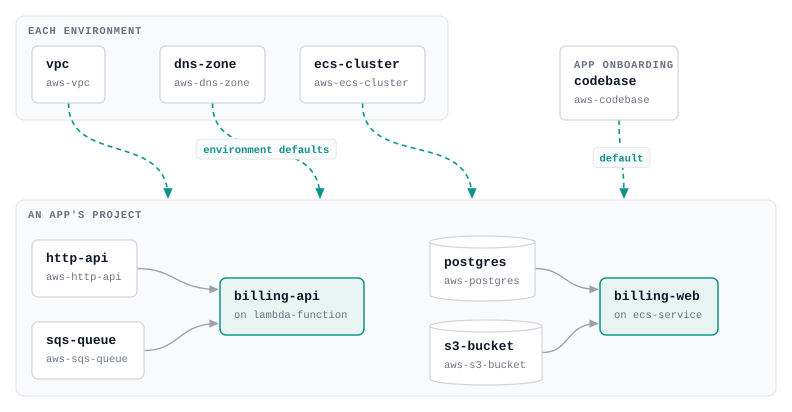

# Massdriver for AWS

Ship apps on AWS with Massdriver. This catalog has the network and DNS for each environment, two ways to run code (Lambda behind API Gateway, or containers on ECS Fargate), the data stores apps usually need, and the pieces that onboard a new app: its GitHub repository, its image registry and its Massdriver project.

## What's in it

### Environment

Deploy these once per environment (`dev`, `prod`) and set each as an environment default. Everything else in the environment finds them on its own.

| Bundle | Makes | Resource type |
|---|---|---|
| `vpc` | A VPC with public, private and internal subnets, and a choice of internet egress | `aws-vpc` |
| `dns-zone` | A Route 53 zone, such as `dev.example.com`, and a certificate for every name under it | `aws-dns-zone` |
| `ecs-cluster` | A Fargate cluster and the load balancer its services share | `aws-ecs-cluster` |
| `github-actions-oidc` | The AWS account's trust in GitHub Actions. Once per account | `aws-github-oidc` |
| `developer-vpn` | A WireGuard tunnel from one developer's laptop into the VPC, for sandboxes. See [docs/developer-vpn.md](docs/developer-vpn.md) | `massdriver-wireguard-tunnel` |

### Runtimes

| Bundle | Makes | Resource type |
|---|---|---|
| `http-api` | An API Gateway HTTP API, optionally at `<subdomain>.<zone>` | `aws-http-api` |
| `lambda-function` | A function that answers routes on an HTTP API, or reads a queue. Apps run on it | — |
| `ecs-service` | A container service on Fargate, at `<subdomain>.<zone>` or as a worker with no address. Apps run on it | — |
| `ecs-agent` | A Claude agent on Fargate with its own Massdriver service account, working on one goal around the clock | — |
| `lab-box` | A private box where a coding agent (OpenCode) builds browser games with a kid, with rules set by the player's age. Reachable only inside the VPC | `lab-endpoint` |
| `dev-workspace` | A developer's workspace on Fargate with Claude Code, OpenCode, `mass`, the Massdriver MCP server and git, a persistent home directory, and a shell through ECS Exec | — |

### Data stores

| Bundle | Makes | Resource type |
|---|---|---|
| `postgres` | RDS for PostgreSQL | `aws-postgres` |
| `mariadb` | RDS for MariaDB | `aws-mariadb` |
| `dynamodb-table` | A DynamoDB table, billed per request | `aws-dynamodb-table` |
| `s3-bucket` | A private S3 bucket | `aws-s3-bucket` |
| `valkey` | A serverless Valkey (Redis-compatible) cache | `aws-valkey` |
| `sqs-queue` | An SQS queue with a dead-letter queue | `aws-sqs-queue` |

### App onboarding

| Bundle | Makes | Resource type |
|---|---|---|
| `ecr-repository` | The app's image repository, with push and pull policies | `aws-ecr-repository` |
| `github-repo` | The app's GitHub repository, with a pipeline that builds, pushes and deploys | `source-repository` |
| `massdriver-project` | The app's Massdriver project, its environments, and a group its pipeline deploys with | `app-project` |
| `codebase` | Where an app's images come from: its registry and, optionally, its repository. Runtimes connect to it | `aws-codebase` |
| `massdriver-<automation>-ecs` | One [Massdriver automation](https://github.com/massdriver-cloud/massdriver-automations) on the cluster each: status page, cost explorer, drift checks, freeze windows, auto-deploys and more | `website`, for the status page and cost explorer |

### Credentials

| Credential | Used by |
|---|---|
| AWS IAM Role (`aws-iam-role`) | Every AWS bundle |
| GitHub App (`github-app`) | `github-repo` |
| Massdriver Service Account (`massdriver-service-account`, from [massdriver-resource-types](https://github.com/massdriver-cloud/massdriver-resource-types)) | `massdriver-project`, `github-repo`, `codebase`, `massdriver-<automation>-ecs`, `ecs-agent`, `dev-workspace` |

The onboarding bundles create projects, groups and service accounts, and share resources, so their Massdriver service account must be in Organization Admin. The type has no environment default: import the service account as a resource and set it as a remote reference on each bundle's **massdriver** slot.

## How it fits together

<picture>
  <source media="(prefers-color-scheme: dark)" srcset="diagrams/how-it-fits.dark.svg">
  
</picture>

Dashed lines are environment defaults; solid lines are links on the app's canvas.

- **Subdomains.** The DNS zone's certificate covers every name one level under it. An `http-api` or `ecs-service` with **Subdomain** `api` answers at `https://api.dev.example.com`, with the record and certificate handled for you. The zone, the API and the cluster must be in the same region. An `ecs-service` takes its VPC and zone from the cluster, so it always lands in the load balancer's network and under its certificate.
- **Databases and caches** sit in the VPC's internal subnets and only accept connections from their own client security group.
- **Policies.** Tables, buckets, queues and registries publish IAM policies such as `read`, `read-write`, `send` or `pull`. Nothing writes its own IAM for a store.

### Apps and runtimes

`lambda-function` and `ecs-service` are runtimes: the infrastructure an app runs on. An app is a small bundle of its own, with no infrastructure code. It names its runtime, declares the data stores it uses, and maps their fields to its environment variables:

```yaml
name: billing
dependencies:
  ledger:
    resource_type: aws-mariadb@0.0.0
    required: true
app:
  runtime: ecs-service
  envs:
    MYSQL_HOST: .dependencies.ledger.hostname
    MYSQL_PASSWORD: '.dependencies.ledger.secret_arn + ":password::"'
```

Massdriver builds the app and its runtime into one bundle when the app is published. The runtime gives the app access to what it connects: it joins a database's or cache's client security group, and attaches the store's policies. On ECS, a variable that points at a Secrets Manager value is read when a task starts and never written into the task definition. The Tendwell apps in [examples/telehealth](examples/telehealth/) are built this way.

## Use it

**Stand up an example.** Each folder in [examples/](examples/) is a whole company built on this catalog. Its `bootstrap.sh` publishes the catalog to your organization and stands up the company: projects, environments, teams and their access, and its apps.

| Example | Company |
|---|---|
| [telehealth](examples/telehealth/) | Tendwell Health: patients book video visits, clinicians chart them, billing files the claims |
| [gamelab](examples/gamelab/) | Gamelab: a parent makes a lab for a kid, and a helper builds the games the kid dreams up. Every lab is a Massdriver environment the app forks through the API |

**Sync it to your organization and build your own.** Fork this repository and connect its publish workflow:

1. In Massdriver, turn on **Settings → General → Grant new bundle repositories to all projects**. Create a service account with a **1 year** token in a group allowed to publish. The examples' `bootstrap.sh` turns that setting off and grants each repository itself, so turn it back on after running one.
2. In the fork's **Settings → Secrets and variables → Actions**, add its key as the secret `MASSDRIVER_API_KEY` and your organization ID as the variable `MASSDRIVER_ORG_ID`.
3. Run **Actions → Publish → Run workflow** with *all* ticked. After that, every push to `main` publishes what changed: credentials and resource types first, then bundles. Until the secret and the variable are set, each run passes with a warning and publishes nothing.

Then add an AWS IAM Role credential, following the instructions on its form, and deploy `vpc`, `dns-zone` and `ecs-cluster` in each environment. A new DNS zone must be delegated from its parent domain before its certificate is issued; the `dns-zone` operator guide shows how. Each runtime's operator guide has a **Ship your app** walkthrough.

## Automation bundles

The `bundles/massdriver-*-ecs` bundles come from [massdriver-automations](https://github.com/massdriver-cloud/massdriver-automations), which generates them. Don't edit them here; the next sync overwrites the change. To bring them up to date:

```bash
scripts/sync-automation-bundles.sh
```

It copies every `-ecs` bundle from `../massdriver-automations`, or from a fresh clone of `main` when that folder is missing, and lists the bundles that changed. Point it elsewhere with `AUTOMATIONS_DIR=<path>`, or clone another branch or tag with `AUTOMATIONS_REF=<ref>`.

This catalog changes a few lines in each bundle. It pins the dependencies to its own resource types, stops production deploys on Checkov failures, and sets the presets to the `latest` image. The `overlay` function in the script makes these changes. If upstream changes one of those lines, the script stops and names the line. Change the overlay to match, or move the change upstream when every catalog needs it.

## Repository layout

```
platforms/        Credentials
resource-types/   Contracts between bundles
bundles/          OpenTofu bundles
examples/         Example companies built on the catalog, with their apps
scripts/          Publishes the official Massdriver resource types; syncs the automation bundles; renders the README diagrams
.github/workflows Publishing
```

## Versioning

Everything this catalog owns publishes as `0.0.0`, which can be republished in place. Publishing any other version to a repository ends that, development releases included: once a repository holds another version, `0.0.0` can't be overwritten there, and the next change needs a version bump.

The automation bundles and the `website` resource type come from massdriver-automations at `0.1.0`. A published `0.1.0` can't change, so publishing skips one the organization already has. A synced change reaches the organization when upstream bumps the version, or as a development release: `mass bundle publish --development`.

## License

[Apache License 2.0](LICENSE).
