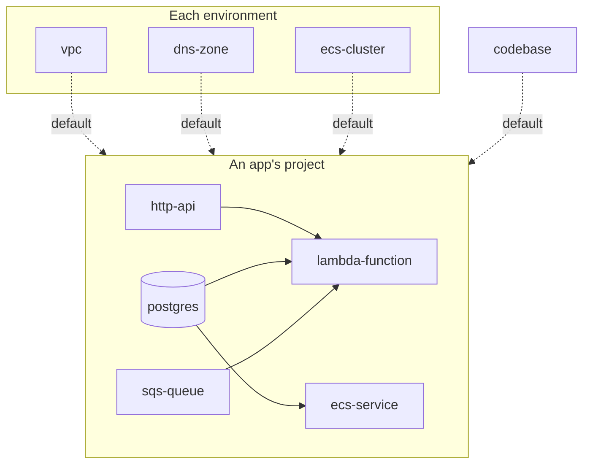
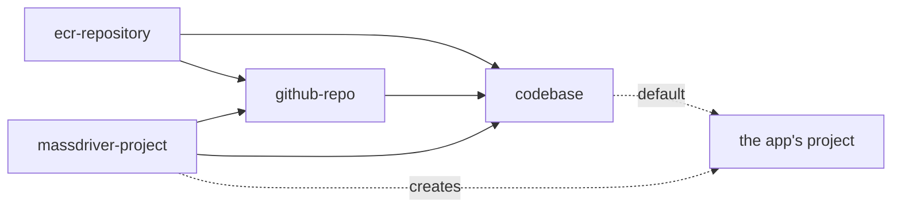

# Massdriver for AWS

Ship apps on AWS with Massdriver. This catalog has the network and DNS for each environment, two ways to run code (Lambda behind API Gateway, or containers on ECS Fargate), the data stores apps usually need, and the pieces that onboard a new app: its GitHub repository, its image registry and its Massdriver project.

## What's in it

### Environment

Deploy these once per environment (dev, staging, production) and set each as an environment default. Everything else in the environment finds them on its own.

| Bundle | Makes | Resource type |
|---|---|---|
| `vpc` | A VPC with public, private and internal subnets, and a choice of internet egress | `aws-vpc` |
| `dns-zone` | A Route 53 zone, such as `dev.example.com`, and a certificate for every name under it | `aws-dns-zone` |
| `ecs-cluster` | A Fargate cluster and the load balancer its services share | `aws-ecs-cluster` |
| `github-actions-oidc` | The AWS account's trust in GitHub Actions. Once per account | `aws-github-oidc` |

### Runtimes

| Bundle | Makes | Resource type |
|---|---|---|
| `http-api` | An API Gateway HTTP API, optionally at `<subdomain>.<zone>` | `aws-http-api` |
| `lambda-function` | A function that answers routes on an HTTP API, or reads a queue | — |
| `ecs-service` | A container service on Fargate, at `<subdomain>.<zone>` or as a worker with no address | — |

### Data stores

| Bundle | Makes | Resource type |
|---|---|---|
| `postgres` | RDS for PostgreSQL | `aws-postgres` |
| `mariadb` | RDS for MariaDB | `aws-mariadb` |
| `dynamodb-table` | A DynamoDB table, billed per request | `aws-dynamodb-table` |
| `s3-bucket` | A private S3 bucket | `aws-s3-bucket` |
| `valkey` | A serverless Valkey (Redis-compatible) cache | `aws-valkey` |
| `sqs-queue` | An SQS queue with a dead-letter queue | `aws-sqs-queue` |

### App onboarding

| Bundle | Makes | Resource type |
|---|---|---|
| `ecr-repository` | The app's image repository, with push and pull policies | `aws-ecr-repository` |
| `github-repo` | The app's GitHub repository, with a pipeline that builds, pushes and deploys | `source-repository` |
| `massdriver-project` | The app's Massdriver project, its environments, and a group its pipeline deploys with | `massdriver-project` |
| `codebase` | The repository and registry as one resource, shared with the app's project | `aws-codebase` |

### Credentials

| Credential | Used by |
|---|---|
| AWS IAM Role (`aws-iam-role`) | Every AWS bundle |
| GitHub App (`github-app`) | `github-repo` |
| Massdriver Service Account (`massdriver-service-account`) | `massdriver-project`, `github-repo`, `codebase` |

## How it fits together



Dotted lines are environment defaults; solid lines are links on the app's canvas.

- **Subdomains.** The DNS zone's certificate covers every name one level under it. An `http-api` or `ecs-service` with **Subdomain** `api` answers at `https://api.dev.example.com`, with the record and certificate handled for you. The zone, the API and the cluster must be in the same region.
- **Databases and caches** sit in the VPC's internal subnets and only accept connections from their own client security group. A runtime joins that group when you link the store to it.
- **Policies.** Tables, buckets, queues and registries publish IAM policies such as `read`, `read-write`, `send` or `pull`. A runtime attaches the one you pick; nothing writes its own IAM for a store.

### Environment variables

Link a data store to a runtime and the runtime gets the same variables on Lambda and ECS:

| Store | Variables |
|---|---|
| PostgreSQL | `PGHOST` `PGPORT` `PGDATABASE` `PGUSER` `PGPASSWORD`, plus `DATABASE_URL` on Lambda |
| MariaDB | `MYSQL_HOST` `MYSQL_PORT` `MYSQL_DATABASE` `MYSQL_USER` `MYSQL_PASSWORD`, plus `MYSQL_URL` on Lambda |
| Valkey | `REDIS_URL` (`rediss://`, TLS) |
| DynamoDB | `TABLE_NAME` |
| S3 | `BUCKET_NAME` |
| SQS | `QUEUE_URL` |

ECS reads passwords from Secrets Manager when a task starts, so it never holds a URL with the password in it. Build the URL in your app from the variables, or let your PostgreSQL client read `PG*` directly.

## Getting started

1. **Publish the catalog.** In Massdriver, turn on **Settings → General → Grant new bundle repositories to all projects**. Create a service account with a **1 year** token in a group allowed to publish. In this repository's **Settings → Secrets and variables → Actions**, add its key as the secret `MASSDRIVER_API_KEY` and your organization ID as the variable `MASSDRIVER_ORG_ID`. Run **Actions → Publish → Run workflow** with *all* ticked. After that, every push to `main` publishes what changed: credentials and resource types first, then bundles.
2. **Add credentials.** Create an AWS IAM Role credential, following the instructions on its form. Add the GitHub App and Massdriver Service Account credentials too if you'll onboard apps from here.
3. **Set up an environment.** Make a `platform` project with an environment per stage (`dev`, `prod`). In each, deploy `vpc`, then `dns-zone`, then `ecs-cluster` if you'll run containers. Deploy `github-actions-oidc` once per AWS account. A new DNS zone must be delegated from its parent domain before its certificate is issued; the `dns-zone` operator guide shows how.
4. **Make the app's project.** Either by hand, or with the onboarding bundles (below). Set the platform's VPC, DNS zone and cluster, the AWS credential, and the codebase as defaults on each of its environments.
5. **Ship the app.** Put `http-api` and `lambda-function`, or `ecs-service`, on the app's canvas, link any data stores, and deploy. Each runtime's operator guide has a **Ship your app** walkthrough: build the image, push it, deploy it, connect a database, add a subdomain.

## Onboarding apps

The onboarding bundles make everything a new app needs outside its own code, in one place: an ECR repository, a GitHub repository with a working pipeline, and a Massdriver project the pipeline can deploy into.

Put `ecr-repository`, `massdriver-project`, `github-repo` and `codebase` on one project's canvas, linked, with an environment per app. [bootstrap/](bootstrap/) does this with one `terraform apply`. Deploying an environment there creates that app's repository, registry and project. The environment list is then the list of apps.



- **The pipeline** pushes images to ECR through GitHub's OIDC tokens, on a role only the repository's default branch can assume, so no AWS keys are stored in GitHub. It deploys with its own Massdriver service account, in a group that can only deploy in the environments you list. Set **Release component** and it deploys every merge to that runtime's `image_uri`.
- **The codebase** is the repository and registry as one resource. Set as the default on the app's environments, it gives every runtime there the registry's pull policy without a link across projects. Environment defaults are a step per environment for now, because Massdriver's Terraform provider can't set them:

  ```bash
  mass environment default <project>-<environment> <resource-id>
  ```

### Attributes

Each attribute key must be defined in the organization before a project can carry it.

| Attribute | On | Example values | For |
|---|---|---|---|
| `project-type` | Projects | `platform`, `ci`, `app-hosting` | Filtering, and policies by kind of project |
| `team` | Projects, environments | `payments` | Who owns it; policies that give a team's group deploy rights |
| `application` | Onboarding environments, app projects | `billing` | Ties an onboarding environment to the project it made |

## Repository layout

```
platforms/        Credentials
resource-types/   Contracts between bundles
bundles/          OpenTofu bundles
bootstrap/        The onboarding project and its canvas
.github/workflows Publishing
```

## Versioning

Everything publishes as `0.0.0`, which can be republished in place. Publishing any other version to a repository ends that, development releases included: once a repository holds another version, `0.0.0` can't be overwritten there, and the next change needs a version bump.

## License

[Apache License 2.0](LICENSE).
