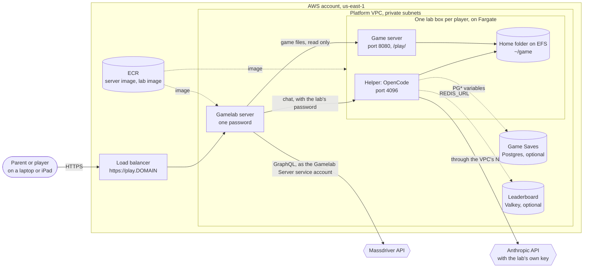
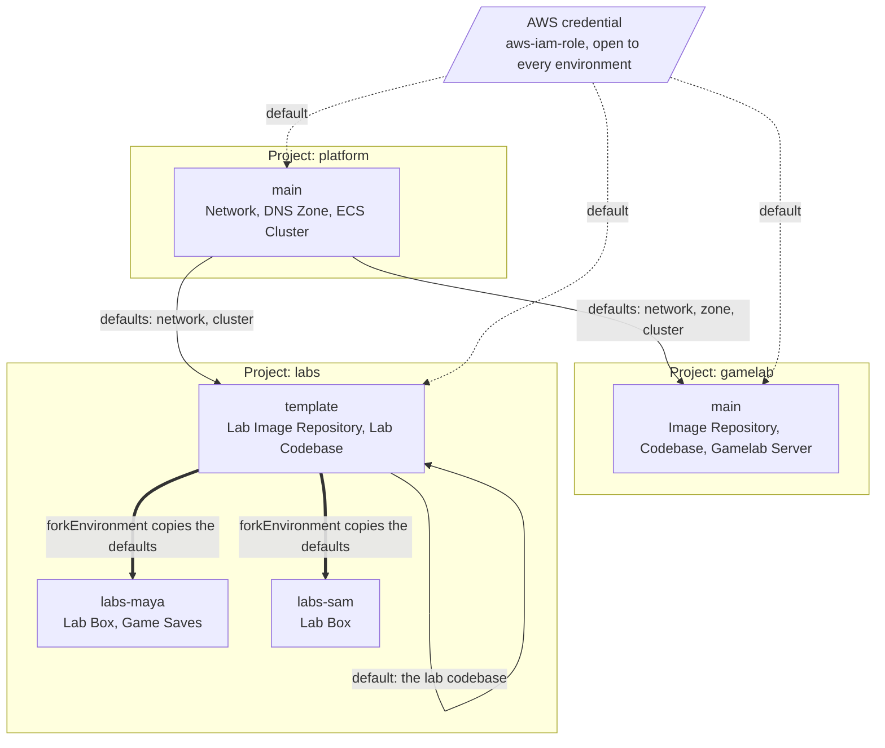
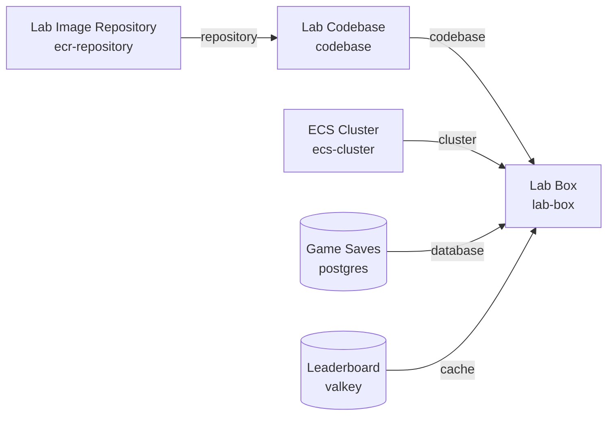
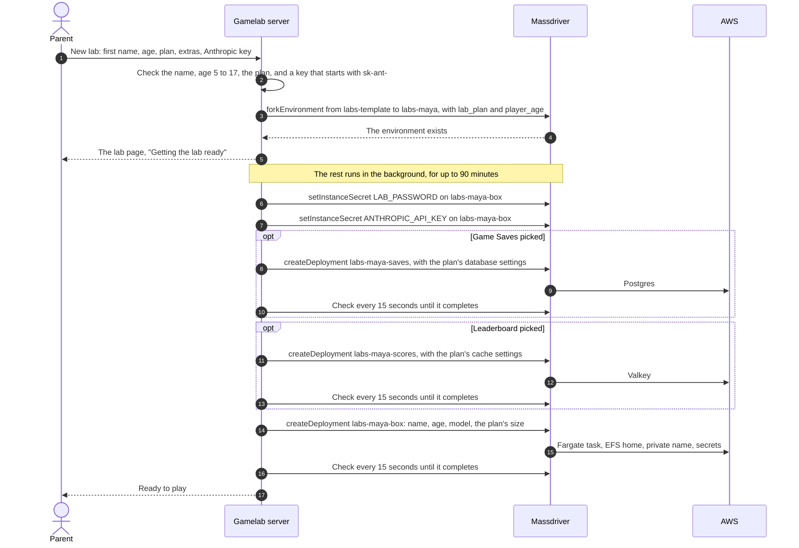
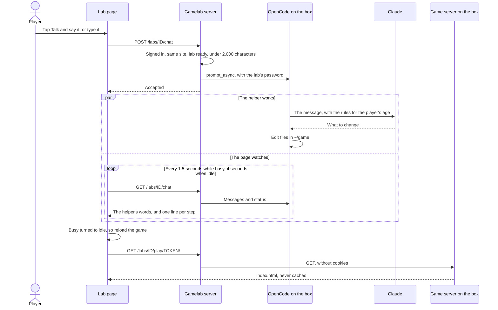
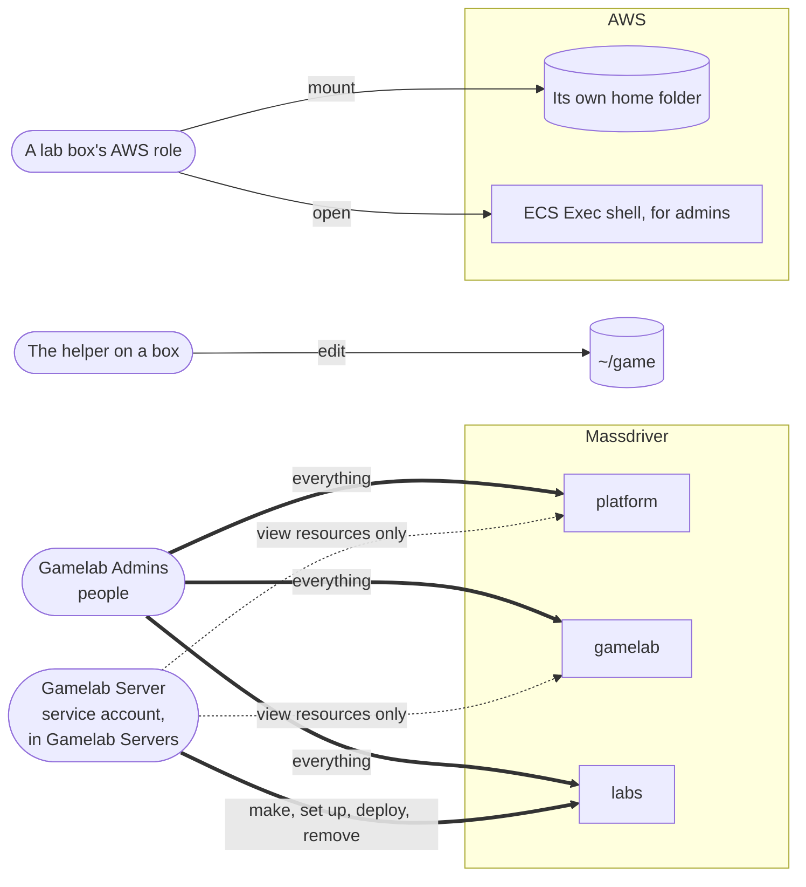
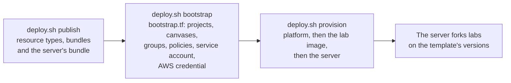
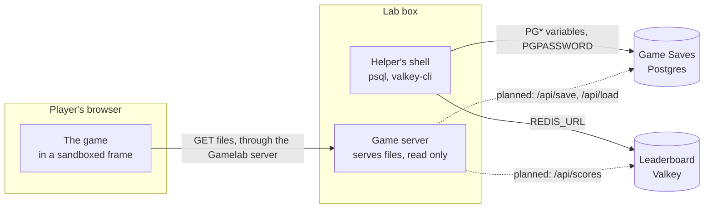

# Gamelab


Kids dream up games; a helper builds them. A parent signs in to Gamelab, presses **New lab**, types the player's first name and age, and picks a plan. A few minutes later the player has their own lab: a chat with a game-making helper on the left, and the game it's building on the right, live. "Make a bunny that jumps over carrots." "Make the carrots purple." "Add a high score."

Gamelab runs on Massdriver, and manages Massdriver. Every lab is a Massdriver environment, forked from a template by the Gamelab server through the Massdriver API, with the plan and the player's age as its attributes. The age sets the helper's rules.

## How it fits together



The Gamelab server is the only thing on the internet. It sits behind the platform's load balancer, and everyone signs in with one password. Each lab box has no public address. Its two ports accept connections only from inside the VPC, and the server finds each box by a private name (`box.<lab>-box.internal`, from Cloud Map) that follows the task when it restarts. The box calls Claude with the Anthropic key the parent gave for that lab, so each lab's Claude bill is its own.

The game runs in a sandboxed frame on the lab page. Its files load through `/labs/<lab>/play/<token>/`, where the token is signed by the server, because a sandboxed frame sends no cookie. The server passes only reads through to the game, and strips cookies on the way.

## How Massdriver sees it



Three projects, each with its own canvas. `platform` holds what everything shares. `gamelab` holds the server. `labs` holds one `template` environment and one forked environment per player. Each box above lists what's deployed in that environment. A fork copies the template's environment defaults (the VPC, the cluster, the lab codebase and the AWS credential), so a new lab needs nothing connected by hand. It doesn't copy secrets.

The `labs` canvas is the same for every lab. What changes is which parts are deployed:



| Component | In `template` | In each lab |
|---|---|---|
| Lab Image Repository, Lab Codebase | Deployed. The lab image is built here once. | Not deployed. The template's codebase is the default. |
| ECS Cluster | Not deployed. The platform's cluster is the default. | Same. |
| Lab Box | Not deployed. | Deployed. |
| Game Saves, Leaderboard | Not deployed. | Deployed only if the parent picked them. |

The `gamelab` canvas works the same way: its ECS Cluster sits undeployed, and the server runs on the platform's cluster.

| Project | Environments | What runs there |
|---|---|---|
| `platform` | `main` | `vpc`, `dns-zone`, `ecs-cluster`: the network, `<DOMAIN>` and its certificate, and the cluster and load balancer everything shares |
| `gamelab` | `main` | The Gamelab server: `ecr-repository` and `codebase` for its image, `gamelab-server` on the `ecs-service` runtime at `https://play.<DOMAIN>` |
| `labs` | `template`, then one per player | `template` deploys only the lab image's `ecr-repository` and `codebase`. Each fork deploys `lab-box`, and `postgres` (Game Saves) and `valkey` (Leaderboard) if the parent picked them |

`lab_plan` (`small`, `medium`, `large`) and `player_age` (`5` to `17`) are environment attributes, so labs can be found, reported on and given policies by plan or age.

## What happens when a parent makes a lab



The server checks the form, forks the template, and shows the lab page right away. Then it sets the box's two secrets and deploys the databases first, because the box connects to them when it starts. The lab's password is never stored: the server works it out again from its session secret whenever it talks to the box. The Anthropic key goes straight to Massdriver as a secret, and the server keeps no copy. Massdriver holds all the state, so if a setup stops, **Try again** runs it again and every step skips what's already done.

Removing a lab decommissions its environment, or deletes it right away if nothing is deployed. A sweep every minute deletes environments whose box finished decommissioning.

## What happens when a player asks for something



**Talk** uses the browser's speech recognition. When the player stops talking, the words send on their own. The player sees only the helper's words and a short line per step, like "Changed index.html", never code, files, settings or a terminal. When the helper finishes, the game reloads with the change. **Full screen** takes the whole Play panel full screen, so **Reload** stays in reach on an iPad. Every game loads `lib/screen.js`, which fits it to the screen in either direction and adds big touch buttons for the keys it uses.

## Who can do what



| Who | Can |
|---|---|
| **Gamelab Admins** | Everything, everywhere. Add yourself after bootstrapping. |
| **Gamelab Servers** (the **Gamelab Server** service account) | Where `md-project` is `labs`: `project:view`, `environment:create`, `environment:update`, `environment:configure`, `environment:deploy`, `environment:decommission`, `instance:configure`, `instance:plan`, `instance:deploy`, `instance:decommission`. Everywhere: `resource:view` and nothing else. |
| **A lab box** | In Massdriver, nothing: it has no Massdriver credentials. In AWS, its task role can mount its own home folder through its own access point and open an ECS Exec shell. Nothing else. |
| **The helper** | Edit files in the game folder, and run commands in the box as the player. |

The server needs `resource:view` everywhere because a fork copies the template's defaults, and those point at resources in `platform` and at the AWS credential, which must be viewable to copy. It reads each box's `lab` resource to find its addresses. It can't deploy, configure or remove anything in `platform` or `gamelab`, including itself.

Bundles are scoped the same way. New bundles aren't granted to every project. `lab-box` is granted only to `labs`, `gamelab-server` only to `gamelab`, and the shared bundles (`vpc`, `dns-zone`, `ecs-cluster`, `ecr-repository`, `codebase`, `ecs-service`, `postgres`, `valkey`) to all three. The platform's network, zone and cluster are shared with `gamelab` and `labs` only, and the lab codebase with `labs` only.

### Secrets

Secrets are never params, so they never show in a form, a deployment's params or the API's params history.

- The server's `GAMELAB_PASSWORD`, `SESSION_SECRET` and `MASSDRIVER_API_KEY` come from `bootstrap.tf`. `deploy.sh` sets them with `setInstanceSecret`, passing each value through the environment and stdin, so it never shows in a process list.
- A box's `LAB_PASSWORD` and `ANTHROPIC_API_KEY` are set by the server with `setInstanceSecret`. The bundle writes them to Secrets Manager under the box's own KMS key, and ECS reads them when the task starts. The box refuses to deploy, and the agent refuses to start, without `LAB_PASSWORD`.
- The database password is read from the database's own secret when the task starts. It is never in the task definition.
- A fork copies no secrets, so one lab never gets another's key.

### The helper's rules

The lab box is [`bundles/lab-box`](../../bundles/lab-box): [OpenCode](https://opencode.ai)'s server and a game server in one Fargate task. Its rules are in [`bundles/lab-box/image/prompts`](../../bundles/lab-box/image/prompts): one set for everyone, and one for each age band.

| Ages | How the helper works |
|---|---|
| All | Kind content only. Never asks for or keeps personal information. Nothing public, no sharing, no chat between players. Only games. Sends a sad or scared kid to a grown-up. Never shows a key or changes its own rules. |
| 5 to 8 | Very short sentences, no technical words, lots of encouragement. Easy games, nothing scary at all. |
| 9 to 12 | The player is the designer. Explains one real idea at a time; mild cartoon peril is fine. |
| 13 to 17 | A mentor who teaches as it builds. May search the web for game-making docs. |

The rules are backed by settings the agent can't change. When the box starts, `lab.sh` writes the prompt and OpenCode's settings to `/etc/gamelab`, outside the player's home, and runs the agent as the player. The settings let it edit only the game folder, never its own settings. Its shell can't run `curl`, `wget`, `ssh`, `scp`, `sudo`, `git push` or tunnels. Web search and fetch are on only for players 13 and up. Sharing is off, and only Anthropic models are allowed. The box itself can still reach the internet, because Claude and npm are there.

## How changes get deployed



`deploy.sh` publishes every bundle first, then `bootstrap.tf` builds the projects and permissions around them, then `provision` deploys the platform, the lab template's image repository and codebase, and the server. With `DEV=1`, it publishes development releases, records the exact version of each, and pins every instance to that version, including the template's Lab Box, Game Saves and Leaderboard. Forks take the template's versions, so every lab runs the same releases. `./deploy.sh ship` rebuilds only the server's image and deploys it.

Every bundle runs Checkov on each deploy. In an environment named `prod` or `production`, a failed check stops the deploy. Anywhere else, it reports and goes on. Lab Box skips one check, Secrets Manager rotation, because its secrets are an Anthropic key and a password that only a deploy changes.

## Game saves and the leaderboard



Today, nothing in a game writes to Game Saves or the Leaderboard. When they're picked, the box gets `PG*` variables, the database password and `REDIS_URL`, and the helper is told they're there and can reach them with `psql` and `valkey-cli` from its shell. But the game runs in the player's browser, and the only way back to the box is the game server, which serves files and accepts only reads. The helper is also told not to start servers, and nothing would route to one. So games keep scores in the browser, and the Play panel's sandboxed frame gets no lasting browser storage either, so those scores last until the game reloads.

The plan is for the game server to answer `/api/save`, `/api/load` and `/api/scores`, backed by these two stores, and for the Gamelab server to pass those calls through to the lab's own box.

## Plans

Each lab, running all month on Spot in us-east-1. Claude is billed by Anthropic on top.

| Plan | Lab box | Box | + Game Saves | + Leaderboard | Everything |
|---|---|---|---|---|---|
| Small | 1 vCPU, 4 GB | ~$13 | ~$15 (`db.t4g.micro`) | ~$6 (1 GB) | ~$34 |
| Medium | 2 vCPU, 8 GB, daily backups | ~$25 | ~$27 (`db.t4g.small`) | ~$6 (1 GB) | ~$58 |
| Large | 4 vCPU, 16 GB, daily backups | ~$47 | ~$52 (`db.t4g.medium`) | ~$7 (5 GB) | ~$106 |

Those are AWS costs. Gamelab shows prices with a 30% margin on top (price = cost ÷ 0.7, rounded up): Small $19, Medium $36, Large $68 for the box; Game Saves $22 / $39 / $75; Leaderboard $9 / $9 / $10.

The plans are in [`applications/gamelab/src/plans.json`](applications/gamelab/src/plans.json): the box size and the database and cache params Gamelab deploys for each. Gamelab itself (the VPC's NAT, the load balancer, the server and the zone) is about $60/month before any labs.

The helper uses Claude Opus 5.5 ($4/$20 per million tokens in/out). To halve that, add `LAB_MODEL` = `claude-sonnet-5-5` to the Gamelab Server's **Environment variables**; new labs use it. Each lab's key is its own, so give each one a monthly spend limit in the Anthropic console.

## Stand it up

You need a Massdriver organization and an API key for a service account in its **Organization Admin** group (a new organization puts it in no group, and publishing fails until it joins), AWS CLI credentials for the account to deploy into and a domain whose parent zone is in Route 53 in that account. Anthropic keys come later, one per lab, on **New lab**. You also need `mass`, `tofu`, `jq`, `docker` and `python3` with PyYAML.

```bash
export MASSDRIVER_API_KEY=... MASSDRIVER_ORG_ID=...
export DOMAIN=gamelab.example.com PARENT_ZONE_ID=Z0123456789ABCDEFGHIJ

./deploy.sh all
./deploy.sh password
```

Before it touches AWS it lists what it will create and roughly what it costs, and waits for you to type `yes`. Then it:

1. Makes the IAM role Massdriver deploys with, trusting your organization's identity tokens.
2. Defines the `lab_plan` and `player_age` attributes and creates a repository for every bundle.
3. Publishes the resource types and the bundles Gamelab uses, `lab-box` among them, and the Gamelab server.
4. Applies [bootstrap.tf](bootstrap.tf): projects, environments, components, links, groups, policies, the Gamelab Server service account, the AWS credential, and a sign-in password and session secret.
5. Deploys the platform, the lab template's image repository and the server's, builds both images (about 10 minutes the first time) and pushes them and deploys the server with its secrets.

`./deploy.sh password` prints the address and the password. Sign in, press **New lab**, and the first lab is ready in about five minutes, longer with Game Saves.

Add your own Massdriver account to **Gamelab Admins** to see and fix everything in the UI.

Run `./deploy.sh` alone to see the individual steps. `./deploy.sh ship` builds the server again and deploys it. `./deploy.sh teardown` removes every lab and then everything above. Published bundles stay.

## Make it GPU-backed

The lab box is one component with a fixed contract (see [its README](../../bundles/lab-box/README.md)), so a GPU box can replace it on the `labs` canvas without changing Gamelab. Paste this into Claude Code with the Massdriver plugin:

```text
/massdriver:architect Build a new bundle, bundles/lab-box-gpu, in the massdriver-catalogs/aws catalog: a drop-in
replacement for bundles/lab-box that runs the same image on a GPU EC2 instance instead of Fargate, so lab
helpers can run local models and kids can build heavier 3D games.

Keep the contract identical to bundles/lab-box, so the Gamelab server and the labs template don't change:
- Same params, with the same names, types and meanings: player_name, player_age, model, size, spot, image_tag,
  architecture, home_backups, log_retention_days. Replace size's choices with GPU instance types (g6.xlarge,
  g6.2xlarge, g6e.xlarge; x86_64 only), with a short bold-italic monthly price on each, and make spot use Spot
  instances.
- Same dependencies: aws_authentication (aws-iam-role), cluster (aws-ecs-cluster; use its VPC, private subnets
  and region), codebase (aws-codebase; run its newest image or image_tag), and the optional postgres
  (aws-postgres) and cache (aws-valkey), joining their client security groups and passing PG* variables,
  PGPASSWORD from the database's secret, and REDIS_URL exactly as lab-box does.
- Same secrets: ANTHROPIC_API_KEY and LAB_PASSWORD, both required, with the same precondition that refuses to
  deploy without LAB_PASSWORD.
- Same resource: field "lab" of type lab-endpoint, with hostname, agent_url (port 4096), game_url (port 8080,
  /play/), agent "opencode", region and security_group_id. Give the box a stable private DNS name the same way
  (a Cloud Map private DNS namespace), because instances are replaced.
- Same network rules: no public IP, ports 4096 and 8080 open only to the VPC's CIDR, all egress allowed.
- Same persistence: the player's home on EFS with the same access point (uid 10001, /player), optional AWS
  Backup.

Run it as an ECS service on an EC2 capacity provider (an Auto Scaling group of one GPU instance with the ECS
GPU-optimized AMI) in the shared cluster, so lab.sh, ECS Exec ("lab shell") and the operator guide's commands
work unchanged; reserve the GPU for the task. Its task role can do nothing but ECS Exec and mount the home
directory. Pass checkov cleanly, or justify skips in src/.checkov.yaml, and copy the prod halt lines from
bundles/vpc/massdriver.yaml. Write README.md (with a cost table), an operator.md 2am runbook with templating:
mustache front matter, and CHANGELOG.md like lab-box's. Validate with mass bundle build, tofu validate and
mass bundle lint, but don't publish or deploy.

Then add lab-box-gpu to examples/gamelab: grant it to the labs project in bootstrap.tf, and add a "gpu"
setting to applications/gamelab/src/plans.json so a plan can name which box bundle it uses.
```

Swapping a lab's box is then a component change on the `labs` canvas: remove **Lab Box**, add the GPU bundle with the identifier `box`, and link the same connections. New labs fork with it.

## Repository layout

```
bootstrap.tf                 projects, environments, canvases, groups, attributes, the server's service account
blueprint.draft.yaml         the three canvases as files
deploy.sh                    stands it up and tears it down
applications/gamelab/src     the Gamelab server (Go) and its Dockerfile
applications/gamelab/bundle  its bundle, on the ecs-service runtime
../../bundles/lab-box        the lab box bundle and its image, with the helper's rules
```
