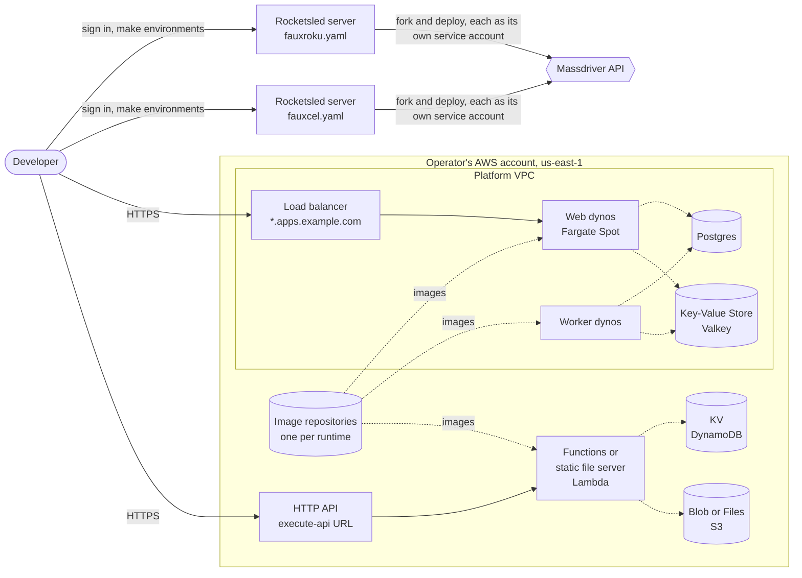

# Rocketsled


Rocketsled builds a PaaS out of Massdriver bundles. This example builds two knock-offs on this catalog and runs them side by side in one Massdriver organization:

- **Fauxroku**, a Heroku. Pick Node.js, Ruby or Python, name an environment `staging`, and get web dynos at `https://ruby-staging.apps.example.com`. Add a worker, Postgres or a Key-Value Store and `DATABASE_URL` and `REDIS_URL` are set. Push a buildpack-built image and it runs.
- **Fauxcel**, a Vercel. Pick Functions or Static, and get an HTTPS endpoint with a function or a static site behind it, plus KV and Blob storage if you want them. It costs nothing until someone calls it.

Customers never see Massdriver and never bring an AWS account: the PaaSes run on the operator's, like the real ones. Each customer environment is a Massdriver environment forked by that PaaS's Rocketsled server from a runtime's template, the way the Gamelab server forks labs. [TOPOLOGY.md](TOPOLOGY.md) explains the model: a platform deployed once, a template per runtime, environments as forks, add-ons deployed or not, promotion by copy.

## How it fits together



Dotted lines are add-ons: there only where the customer picked them.

## Fauxroku

Three runtimes, `node`, `ruby` and `python`, each a project with a template. Every Fauxroku environment runs on the shared platform (`vpc` with a NAT instance, `dns-zone`, `ecs-cluster`), so it costs only its own dynos and add-ons.

| Component | Bundle | Add-on | What the developer gets |
|---|---|---|---|
| Web Dynos | `fauxroku-node`, `fauxroku-ruby` or `fauxroku-python`, on `ecs-service` | no | Their image at `<runtime>-<environment>.<DOMAIN>`, with `PORT` and the language's production defaults |
| Worker Dynos | `fauxroku-worker` on `ecs-service` | yes | The same image with no address and `PROCESS_TYPE=worker` |
| Postgres | `postgres` | yes | RDS PostgreSQL; `DATABASE_URL` and `PGPASSWORD` |
| Key-Value Store | `valkey` | yes | ElastiCache Serverless Valkey; `REDIS_URL` (TLS) |
| Image Repository, Codebase | `ecr-repository`, `codebase` | deployed in the template | Where `pack build --publish` sends the image |

| Plan | What you get | About |
|---|---|---|
| Web or worker, Development | 1 dyno, 0.25 vCPU, 0.5 GB | $7/month, $2 on Spot |
| Web or worker, Production | 2 dynos, 1 vCPU, 2 GB, up to 6 when busy | $58/month |
| Postgres, Development | db.t4g.micro, 20 GB, 1 day of backups | $15/month |
| Postgres, Production | db.m7g.large with a standby, 100 GB, 14 days of backups | $285/month |
| Key-Value Store, Development | up to 1 GB | $6/month |
| Key-Value Store, Production | up to 10 GB, snapshots | $65/month |
| Shared platform | VPC with a NAT instance, DNS zone, load balancer | $25/month in all |

`./deploy.sh fork ruby staging` makes the cheapest environment: one web dyno on Spot, about $2 a month on top of the platform. `./deploy.sh fork ruby staging db cache` adds Postgres and a Key-Value Store.

## Fauxcel

Two runtimes, `functions` and `static`. Nothing is shared and nothing runs while idle.

| Component | Bundle | Add-on | What the developer gets |
|---|---|---|---|
| Endpoint | `http-api` | no | An HTTPS URL on execute-api |
| Functions | `fauxcel-functions` on `lambda-function` | no (functions) | Their arm64 image answering every route, with `KV_TABLE` and `BLOB_BUCKET` |
| KV | `dynamodb-table` | yes (functions) | An on-demand table the function can read and write |
| Blob | `s3-bucket` | yes (functions) | A private bucket the function can read and write |
| Site | `fauxcel-static` on `lambda-function` | no (static) | A small file server that serves the Files bucket, with single-page-app fallback |
| Files | `s3-bucket` | no (static) | Where `aws s3 sync dist/` deploys to |
| Image Repository, Codebase | `ecr-repository`, `codebase` | deployed in the template | The function's image; for static, the file server built once |

Every Development preset fits in AWS's free tier or bills per request. What Vercel has and this catalog doesn't: an edge cache in front (there's no CloudFront bundle yet, so the static site is served by a function rather than from the edge) and public Blob URLs (`s3-bucket` is private by design).

## The Rocketsled side

[`fauxroku.yaml`](fauxroku.yaml) and [`fauxcel.yaml`](fauxcel.yaml) each stand up one Rocketsled server for one PaaS, wearing its skin from [`skins/`](skins/): Fauxroku's purple gradients and beveled buttons, Fauxcel's black, white and monospace. Most of what the configs say is waiting on Rocketsled features, tracked in [massdriver-cloud/rocketsled](https://github.com/massdriver-cloud/rocketsled/issues):

| Key | What it does | Issue |
|---|---|---|
| `massdriver.account_mode: tenant`, `paas` | Serve forks of existing templates; no install, no customer credential | [#10](https://github.com/massdriver-cloud/rocketsled/issues/10) |
| `skin` | Name, logo, design tokens, layout, copy and CSS, loaded at runtime | [#14](https://github.com/massdriver-cloud/rocketsled/issues/14) (subsumes [#1](https://github.com/massdriver-cloud/rocketsled/issues/1)) |
| `paas.platform` | The shared platform, deployed once and pinned as defaults | [#15](https://github.com/massdriver-cloud/rocketsled/issues/15) |
| `paas.runtimes` | Several templates per PaaS; an app is its own project | [#16](https://github.com/massdriver-cloud/rocketsled/issues/16) |
| `paas.pinned` | Each environment's own subdomain, whatever the preset | [#11](https://github.com/massdriver-cloud/rocketsled/issues/11) |
| `app_component`, `image_param` | Push to deploy: a release endpoint with deploy tokens | [#5](https://github.com/massdriver-cloud/rocketsled/issues/5) |
| `paas.addons` | Deploy an add-on or don't | [#3](https://github.com/massdriver-cloud/rocketsled/issues/3) |
| `paas.pipeline` | Stages, and promotion by copy | [#4](https://github.com/massdriver-cloud/rocketsled/issues/4) |
| `paas.previews` | Review apps and preview deployments per pull request | [#6](https://github.com/massdriver-cloud/rocketsled/issues/6) |
| `paas.domains` | Custom domains | [#7](https://github.com/massdriver-cloud/rocketsled/issues/7) |
| `paas.plans` | Prices on plan cards | [#8](https://github.com/massdriver-cloud/rocketsled/issues/8) |
| `paas.highlights` | The app's URL first on the environment page | [#9](https://github.com/massdriver-cloud/rocketsled/issues/9) |

Until #10, #11 and #3 land, `./deploy.sh fork` does what the server will: fork the template, apply each picked component's cheapest preset and the environment's subdomain, pin the template's versions, and deploy only what was picked.

## Stand it up

In Massdriver, give the organization `logo.png` as its icon (**Settings → General**). Then:

```bash
export MASSDRIVER_PROFILE=rocketsled
DOMAIN=apps.example.com PARENT_ZONE_ID=Z0123456789 ./deploy.sh all
./deploy.sh fork static demo         # free while idle
./deploy.sh fork ruby staging        # about $2/month on top of the platform
```

`all` publishes every bundle as a development release, applies [`bootstrap.tf`](bootstrap.tf) (the platform project, a project and template per runtime, a service account per PaaS, the AWS credential), deploys the platform and each template's image repository and codebase (about $25 a month in all), builds the static file server, and writes `.env` with both servers' Massdriver keys. Every step asks before it touches AWS.

Then, from a Rocketsled checkout next to this repository:

```bash
bin/rocketsled serve -config ../aws/examples/rocketsled/fauxroku.yaml -env-file ../aws/examples/rocketsled/.env
bin/rocketsled serve -config ../aws/examples/rocketsled/fauxcel.yaml -env-file ../aws/examples/rocketsled/.env
```

Each also needs a session secret, a base URL and a GitHub OAuth app in its environment (`FAUXROKU_SESSION_SECRET`, `FAUXROKU_BASE_URL`, `FAUXROKU_GITHUB_CLIENT_ID`, `FAUXROKU_GITHUB_CLIENT_SECRET`, and the same for `FAUXCEL_`).

`./deploy.sh teardown` removes every customer environment, the templates' repositories, the platform and everything `bootstrap.tf` made.

## Files

```
TOPOLOGY.md                  platform, runtimes, environments, add-ons, promotion
bootstrap.tf                 the projects, templates, links, credential and server accounts
deploy.sh                    role, publish, bootstrap, provision, fork, env, teardown
blueprint.draft.yaml         the six canvases as files
fauxroku.yaml, fauxcel.yaml  the Rocketsled servers
skins/                       each PaaS's look: skin.json, logo.svg, skin.css
applications/fauxroku-*      web dynos per language, and the worker, on ecs-service
applications/fauxcel-*       functions, and the static file server, on lambda-function
```
