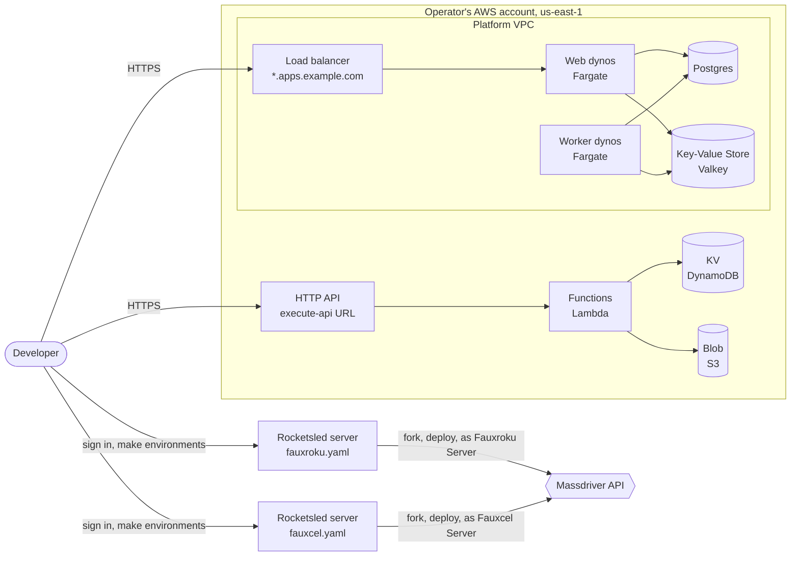
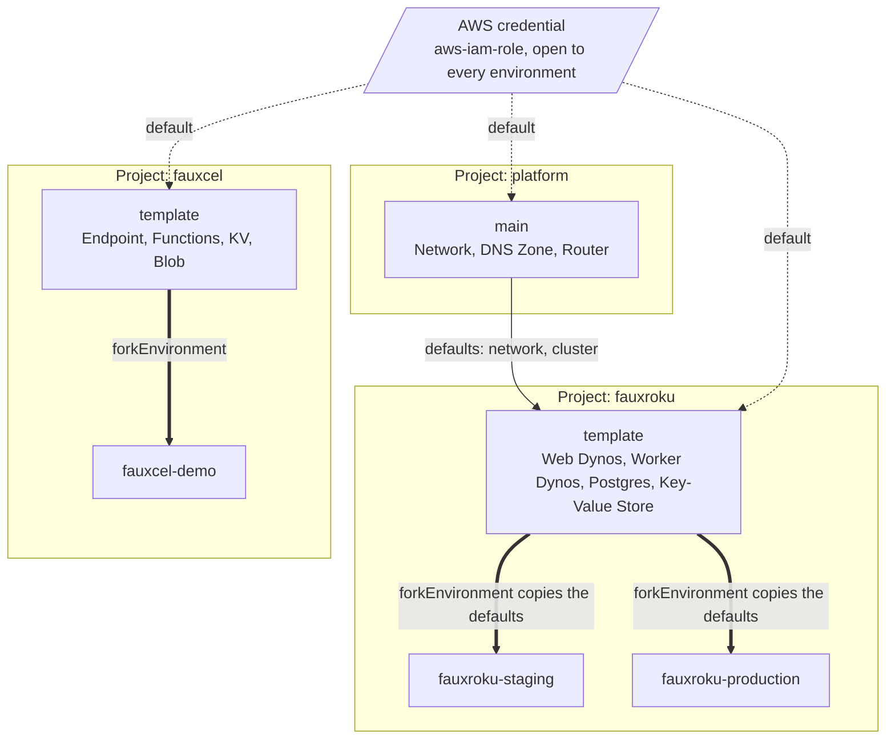

# Rocketsled


Rocketsled builds a PaaS out of Massdriver bundles. This example builds two knock-offs on this catalog and runs them side by side in one Massdriver organization:

- **Fauxroku**, a Heroku. A developer signs in, makes an environment called `staging`, and gets web dynos at `https://fauxroku-staging.apps.example.com`, a worker, Postgres and a Key-Value Store, with `DATABASE_URL` and `REDIS_URL` already set. They push an image and it runs.
- **Fauxcel**, a Vercel. A developer makes an environment and gets an HTTPS endpoint with serverless functions behind it, plus KV and Blob storage. It costs nothing until someone calls it.

Customers never see Massdriver, and never bring an AWS account: Fauxroku and Fauxcel run on the operator's, like the real ones. Each customer environment is a Massdriver environment, forked by that PaaS's Rocketsled server from a template, the same way the Gamelab server forks labs.

## How it fits together



Fauxroku apps share one VPC, one load balancer and one wildcard certificate, the way Heroku's common runtime does, so a new app costs only its own dynos and add-ons. Fauxcel shares nothing: each environment has its own API and function, and both bill per request.

## How Massdriver sees it



Nothing in a template is deployed. A fork copies the template's defaults and its bundle versions, gets one preset per component, and deploys. Each PaaS's Rocketsled server signs in as its own service account, which may fork, deploy and remove environments in its own project and nothing else.

## Fauxroku

| Component | Bundle | Plans | What the developer gets |
|---|---|---|---|
| Web Dynos | `fauxroku-web` on `ecs-service` | Development, Production | Their image behind the router at `<environment>.<DOMAIN>`, with `PORT`, `DATABASE_URL`, `PGPASSWORD`, `REDIS_URL` |
| Worker Dynos | `fauxroku-worker` on `ecs-service` | Development, Production | The same image with no address and `PROCESS_TYPE=worker` |
| Postgres | `postgres` | Development, Production | RDS PostgreSQL in the platform VPC |
| Key-Value Store | `valkey` | Development, Production | ElastiCache Serverless Valkey, TLS only |

On the shared platform: `vpc` (NAT instance), `dns-zone` (the apps domain and its wildcard certificate) and `ecs-cluster` (the router: one load balancer for every app).

| Plan | What you get | About |
|---|---|---|
| Web or worker, Development | 1 dyno, 0.25 vCPU, 0.5 GB | $7/month, $2 on Spot |
| Web or worker, Production | 2 dynos, 1 vCPU, 2 GB, up to 6 when busy | $58/month |
| Postgres, Development | db.t4g.micro, 20 GB, 1 day of backups | $15/month |
| Postgres, Production | db.m7g.large with a standby, 100 GB, 14 days of backups | $285/month |
| Key-Value Store, Development | up to 1 GB | $6/month |
| Key-Value Store, Production | up to 10 GB, snapshots | $65/month |
| Shared platform | VPC with a NAT instance, DNS zone, load balancer | $25/month in all |

`./deploy.sh fork fauxroku <id>` makes the cheapest environment: everything on Development, dynos on Spot. About $25 a month on top of the platform.

Procfile words map onto params: `web:` is the image's command, `worker:` is the same image with `PROCESS_TYPE=worker`, and the runtime's **Task size**, **Tasks** and **Most tasks when busy** are the dyno size and `ps:scale`.

## Fauxcel

| Component | Bundle | Plans | What the developer gets |
|---|---|---|---|
| Endpoint | `http-api` | Development, Production | An HTTPS URL on execute-api, throttled |
| Functions | `fauxcel-app` on `lambda-function` | Development, Production | Their arm64 image answering every route, with `KV_TABLE` and `BLOB_BUCKET` |
| KV | `dynamodb-table` | Development, Production | An on-demand table the function can read and write |
| Blob | `s3-bucket` | Development, Production | A private bucket the function can read and write |

| Plan | What you get | About |
|---|---|---|
| Functions, Development | 256 MB, 10 seconds, 1 day of logs | free tier |
| Functions, Production | 1 GB, 29 seconds, logs kept a year | per request |
| Endpoint, Development | 50 requests a second | free tier, then $1 per million |
| KV, Development | on-demand, no backups | per request |
| Blob, Development | S3-managed encryption, no old versions | $0.023/GB-month |

A Fauxcel environment costs nothing while idle.

What Vercel has and this catalog doesn't: an edge cache in front of the site (no CloudFront bundle here yet), and public Blob URLs (`s3-bucket` is private by design). Frameworks serve their static files from the function instead.

## The Rocketsled side

[`fauxroku.yaml`](fauxroku.yaml) and [`fauxcel.yaml`](fauxcel.yaml) each stand up one branded Rocketsled server for one PaaS. Most of what they say is waiting on Rocketsled features, tracked in [massdriver-cloud/rocketsled](https://github.com/massdriver-cloud/rocketsled/issues):

| Key | What it does | Issue |
|---|---|---|
| `massdriver.account_mode: tenant`, `paas.project`, `paas.template` | Serve forks of an existing template; no install, no customer credential | [#10](https://github.com/massdriver-cloud/rocketsled/issues/10) |
| `brand` | Fauxroku's or Fauxcel's name, logo and colors | [#1](https://github.com/massdriver-cloud/rocketsled/issues/1) |
| `paas.pinned` | Each environment's own subdomain, whatever the preset | [#11](https://github.com/massdriver-cloud/rocketsled/issues/11) |
| `paas.app_component`, `paas.image_param` | Push to deploy: a release endpoint with deploy tokens | [#5](https://github.com/massdriver-cloud/rocketsled/issues/5) |
| `paas.addons` | Postgres, Key-Value Store, workers, KV and Blob only where wanted | [#3](https://github.com/massdriver-cloud/rocketsled/issues/3) |
| `paas.pipeline` | development → staging → production, and promote | [#4](https://github.com/massdriver-cloud/rocketsled/issues/4) |
| `paas.previews` | Review apps and preview deployments per pull request | [#6](https://github.com/massdriver-cloud/rocketsled/issues/6) |
| `paas.domains` | Custom domains | [#7](https://github.com/massdriver-cloud/rocketsled/issues/7) |
| `paas.plans` | Prices on plan cards | [#8](https://github.com/massdriver-cloud/rocketsled/issues/8) |
| `paas.highlights` | The app's URL first on the environment page | [#9](https://github.com/massdriver-cloud/rocketsled/issues/9) |

Until #10 and #11 land, `./deploy.sh fork` does what the server will: `mass environment preview` with the template as the base, each component's cheapest preset, the environment's subdomain, and the template's bundle versions.

## Stand it up

In Massdriver, give the organization `logo.png` as its icon (**Settings → General**). Then:

```bash
export MASSDRIVER_PROFILE=rocketsled
DOMAIN=apps.example.com PARENT_ZONE_ID=Z0123456789 ./deploy.sh all
./deploy.sh fork fauxcel demo        # free while idle
./deploy.sh fork fauxroku staging    # about $25/month
```

`all` publishes every bundle as a development release, applies [`bootstrap.tf`](bootstrap.tf) (projects, templates, links, the AWS credential, a service account per PaaS), deploys the shared platform, and writes `.env` with both servers' Massdriver keys. Every step asks before it touches AWS.

Then, from a Rocketsled checkout next to this repository:

```bash
bin/rocketsled serve -config ../aws/examples/rocketsled/fauxroku.yaml -env-file ../aws/examples/rocketsled/.env
bin/rocketsled serve -config ../aws/examples/rocketsled/fauxcel.yaml -env-file ../aws/examples/rocketsled/.env
```

Each also needs a session secret, a base URL and a GitHub OAuth app in its environment (`FAUXROKU_SESSION_SECRET`, `FAUXROKU_BASE_URL`, `FAUXROKU_GITHUB_CLIENT_ID`, `FAUXROKU_GITHUB_CLIENT_SECRET`, and the same for `FAUXCEL_`).

`./deploy.sh teardown` removes every customer environment, the platform and everything `bootstrap.tf` made.

## Files

```
bootstrap.tf                 projects, templates, links, credential, a service account per PaaS
deploy.sh                    role, publish, bootstrap, provision, fork, env, teardown
blueprint.draft.yaml         the three canvases as files
fauxroku.yaml, fauxcel.yaml  the Rocketsled servers
applications/fauxroku-web    web dynos: an app on the ecs-service runtime
applications/fauxroku-worker worker dynos: an app on the ecs-service runtime
applications/fauxcel-app     functions: an app on the lambda-function runtime
```
