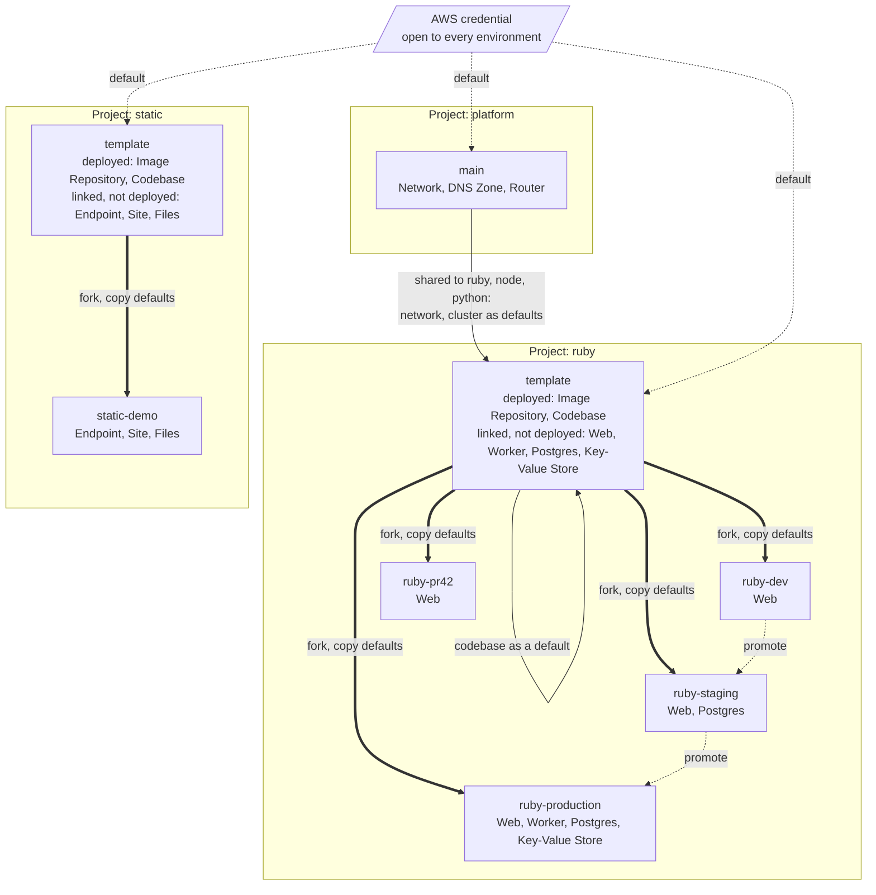

# How a Rocketsled PaaS maps onto Massdriver

A PaaS has four layers. Each one is a different Massdriver shape, and getting the shape right is what keeps a new app cheap and a new environment fast.

| Layer | Massdriver shape | Deployed | Fauxroku | Fauxcel |
|---|---|---|---|---|
| Platform | one project, one environment | once | `platform-main`: VPC, DNS zone, ECS cluster and its load balancer | none |
| Runtime | a template environment in a project | its image repository and codebase only | `node`, `ruby`, `python` | `functions`, `static` |
| Environment | a fork of a template | the runtime component and the add-ons picked | `ruby-staging`, `ruby-production` | `static-demo` |
| Add-on | a component linked in the template, left undeployed | only where picked | worker, Postgres, Key-Value Store | KV, Blob |

## The picture



## Platform: deployed once

The parts every app shares and nobody wants one of per app: the network, the domain and its wildcard certificate, the cluster and its load balancer. They sit in their own project and deploy once.

Apps reach them through environment defaults, never links:

```bash
mass resource grant create platform-main-cluster.cluster --condition md-project=ruby
mass environment default ruby-template platform-main-cluster.cluster
```

A fork made with `copyEnvironmentDefaults` inherits the default, so a new environment needs no wiring. This is why a Fauxroku environment costs only its dynos and add-ons: about $2 a month on Spot, not the $25 a VPC and load balancer would add.

A serverless PaaS like Fauxcel has no platform. Each environment's endpoint and functions bill per request, and sharing them would only couple customers.

## Runtimes: a template per kind of app

A runtime is a project with a `template` environment. The template's canvas has everything an app of that kind could use, linked:

- the **runtime component** (`fauxroku-ruby` on `ecs-service`, `fauxcel-functions` on `lambda-function`), an app bundle that adds the runtime's defaults and maps add-ons to environment variables;
- the **image repository and codebase**, deployed in the template and set as its default, so every environment of the runtime pulls from one place;
- the **add-ons**, linked and left undeployed.

Nothing else in the template is ever deployed. It is a pattern, not an environment.

Here each runtime is one project shared by every app of that kind. The fuller model is a project per app, made from the runtime's blueprint when the customer creates the app, so one app's stages and previews share a canvas and nothing else (rocketsled#16).

## Environments: forks with presets

Making an environment is:

1. `forkEnvironment` from the template with `copyEnvironmentDefaults`.
2. For each component the customer picked, the runtime component and any add-ons: apply its preset, plus the params no preset can know, like the web dynos' subdomain (rocketsled#11), and pin the template's bundle version.
3. Deploy those components, add-ons first. Everything else stays on the canvas, undeployed.

Pipeline stages and previews are the same operation with different defaults. A stage is a long-lived fork with stage presets (rocketsled#4). A preview is a short-lived fork with the cheapest presets, named for its pull request and removed when it closes or goes quiet (rocketsled#6).

## Add-ons: deploy or don't

An add-on is a component on the template's canvas, linked to the runtime component through an optional dependency. Picking it deploys it; not picking it leaves it undeployed, and the runtime component deploys with that connection empty (`DATABASE_URL=""`). Adding one later deploys it and then redeploys the runtime component so it picks up the connection. Removing one is the reverse. No canvas changes, ever (rocketsled#3).

## Promotion: copy, don't rebuild

Promoting staging to production copies the runtime component's config and bundle version with `copyInstance`, keeping the fields production's preset owns (size, counts, Spot) and its pinned params, then deploys only what changed. The image that passed staging is the image production runs. Add-ons aren't promoted; production has its own data (rocketsled#4).

## What the engine needs

| Change | Issue |
|---|---|
| Serve forks of existing templates in an operator's organization | [#10](https://github.com/massdriver-cloud/rocketsled/issues/10) |
| Platform layer deployed once and pinned as defaults | [#15](https://github.com/massdriver-cloud/rocketsled/issues/15) |
| Several runtimes per PaaS; an app is its own project | [#16](https://github.com/massdriver-cloud/rocketsled/issues/16) |
| Add-ons: deploy or don't | [#3](https://github.com/massdriver-cloud/rocketsled/issues/3) |
| Pinned params over presets | [#11](https://github.com/massdriver-cloud/rocketsled/issues/11) |
| Stages and promotion by copy | [#4](https://github.com/massdriver-cloud/rocketsled/issues/4) |
| Preview environments | [#6](https://github.com/massdriver-cloud/rocketsled/issues/6) |
| Releases with deploy tokens | [#5](https://github.com/massdriver-cloud/rocketsled/issues/5) |

Rocketsled does steps 1 to 3 since #10, #16, #3 and #11. `./bootstrap.sh fork <runtime> <id> [add-on...]` does the same by hand.
