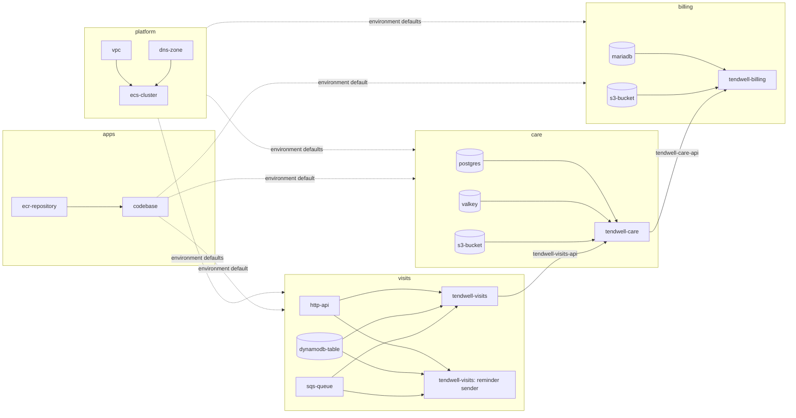

# Tendwell Health


A telehealth company built on this catalog. Patients book video visits, clinicians chart them, and a billing team files the insurance claims.

| Project | Team | What runs there |
|---|---|---|
| `platform` | Platform Engineering | `vpc`, `dns-zone`, `ecs-cluster`, `github-actions-oidc` |
| `apps` | Platform Engineering | App onboarding, one environment per app: `ecr-repository` and `codebase`, plus `github-repo` and `massdriver-project` for a governed repository and pipeline |
| `visits` | Patient Experience | The booking API on Lambda: `http-api`, `dynamodb-table`, `sqs-queue`, `tendwell-visits` twice (the API, and the reminder sender) |
| `care` | Clinical | The clinician portal on ECS: `postgres`, `valkey`, `s3-bucket`, `tendwell-care` |
| `billing` | Revenue | Claims on ECS: `mariadb`, `s3-bucket`, `tendwell-billing` |
| `sreagent` | Platform Engineering | Jimmy, a Claude agent that watches dev and proposes fixes: `ecs-agent`, on the platform's dev cluster |
| `sandboxes` | Platform Engineering | An environment per developer, forked from `template`: `dev-workspace` and `developer-vpn`, on the platform's dev cluster and VPC |

`platform`, `visits`, `care` and `billing` have `dev` and `prod`. `apps` has one environment per app, where the platform team onboards it: an image registry and a codebase, shared with the app's project and set as the default in its dev and prod, so both run the same images. Prod deploys need a second person's approval.

The `apps` canvas also has `github-repo` and `massdriver-project`, which `bootstrap.sh` leaves undeployed. Deploying them gives an app a GitHub repository with a pipeline that builds, pushes and deploys, and a Massdriver project of its own; connect both to the codebase and it carries the repository too. `bootstrap.tf` makes an App Onboarding service account in Platform Engineering, and `bootstrap.sh` connects both bundles to it; they also need the GitHub App credential as the environment's default. `bootstrap.tf` already makes the Visits, Care and Billing projects, so Tendwell doesn't use them.

Each team's group can change only its own project and read the rest. Platform Engineering can change everything, and Security & Compliance can read everything and change nothing.

`sreagent` has one environment per agent. Jimmy, in `jimmy`, runs on the platform's dev cluster as his own service account in SRE Agents, which can read everything and propose deploys in dev that a person approves. `bootstrap.sh provision dev` deploys him when `ANTHROPIC_API_KEY` and `AGENT_IMAGE` are set; [`bundles/ecs-agent`](../../bundles/ecs-agent) shows how to build the image.

`sandboxes` has a `template`, and sandbox-on-join forks it for each person who joins a team. The template deploys the workspace image's registry and codebase once; `bootstrap.sh provision dev` builds [`bundles/dev-workspace/image`](../../bundles/dev-workspace) into it and sets the codebase, the dev cluster and VPC, and a Sandbox Provisioner credential as the template's defaults, which every fork copies. In a fork, the developer deploys **Workspace** for a shell with Claude Code, OpenCode, `mass` and git, and **Developer VPN** to reach the dev VPC from their laptop. `./bootstrap.sh sandbox <name>` does the same by hand and prints the command to get in.



## The apps

Each app in [applications/](applications/) has:

- `src/`: the app and its Dockerfile.
- `bundle/`: the app's bundle. It has no infrastructure code of its own: it runs on the catalog's `lambda-function` or `ecs-service` runtime, declares the databases, caches and queues the app uses, maps their fields to the app's environment variables, and publishes the app's resource.
- `resource-type/`: that resource, so other apps connect to it by contract. Care reads the Visits API's URL; Billing reads Care's.
- `blueprint.draft.yaml`: the project's design as a file, in the draft blueprint format.

## Demo

### Find the apps

Each app publishes its address. Open **Care**, **Billing** or **Visits** on its project's canvas and the `url` is in the resource it publishes. From a terminal:

```bash
mass resource get care-dev-app.care -o json | jq -r .payload.url
mass resource get billing-dev-app.billing -o json | jq -r .payload.url
mass resource get visits-dev-app.visits -o json | jq -r .payload.url
```

### Walk through it

1. **Care** is the clinician portal. **Book visit** takes an open slot from the Visits API, which saves the booking in DynamoDB and queues a reminder that the Reminder Sender picks up. **Close visit** saves the encounter in Postgres and the note in S3.
2. **Billing** is the claims ledger. **Run claims** pulls Care's closed encounters and files them as claims in MariaDB and S3. With the **Clearinghouse API key** secret set on the Billing instance, each claim is signed and the ledger shows the key as connected.
3. **Visits** has no screen. `GET /slots` and `GET /appointments` show what Care reads.

### Set off an alarm

| Do this | Alarm | Fires after |
|---|---|---|
| In Care, book a visit for **Alex Rivera**. The booking works, but Alex's email bounces, so the reminder fails every try (three in dev) and moves to the dead-letter queue. | **Reminders Queue**: dead letters | About 5–8 minutes |
| On Care's instance, set **Alarm when responses are slower than (ms)** to `100`, deploy, and keep clicking around Care. Its pages take about 350 ms. | **Care**: slow responses | 15 minutes of traffic |

A dead-letter message stays for 14 days, so that alarm keeps firing until the message expires or someone clears the queue. Set the response alarm back to `1000` when you're done.

## Stand it up

You need an organization with a service account in the Organization Admin group, AWS CLI credentials for the account to deploy into, and a domain whose Route 53 zone is in that account. You also need `mass`, `tofu`, `jq`, `docker` and `python3` with PyYAML.

```bash
export MASSDRIVER_API_KEY=... MASSDRIVER_ORG_ID=...
export DOMAIN=tendwell.example PARENT_ZONE_ID=Z0123456789ABCDEFGHIJ

./bootstrap.sh all dev
```

Before it touches AWS it lists the account, everything it will create and roughly what it costs, and waits for you to type `yes`. Then it:

1. Makes the IAM role Massdriver deploys with, trusting your organization's identity tokens.
2. Sets up a daily AWS Cost and Usage Report and connects it to Massdriver, so every instance shows what it costs.
3. Defines the `team` and `data_classification` attributes, tags every cloud resource with them, and creates a repository for every bundle.
4. Publishes the catalog and the apps.
5. Applies [bootstrap.tf](bootstrap.tf): projects, environments, components, links, groups, policies and the AWS credentials.
6. Deploys dev, then builds and ships each app.

To read costs from tags in the report itself, run in the AWS management (payer) account with `COST_ALLOCATION_TAGS=md-instance`. AWS only accepts it once the tag shows up in billing data, up to a day after the first deploy, so rerun `./bootstrap.sh costs` with it then. Keep it set on later runs of `costs` or `all`; without it they turn the tags back off.

For a separate prod account, make a role there from the AWS IAM Role credential's instructions and set `PROD_ROLE_ARN`. The apps then answer at `visits.dev.<domain>`, `care.dev.<domain>` and `billing.dev.<domain>`.

Run `./bootstrap.sh` alone to see the individual steps. `./bootstrap.sh teardown` removes all of it again: it decommissions every instance, then undoes bootstrap.tf, the cost report and the IAM role. Published bundles stay.
