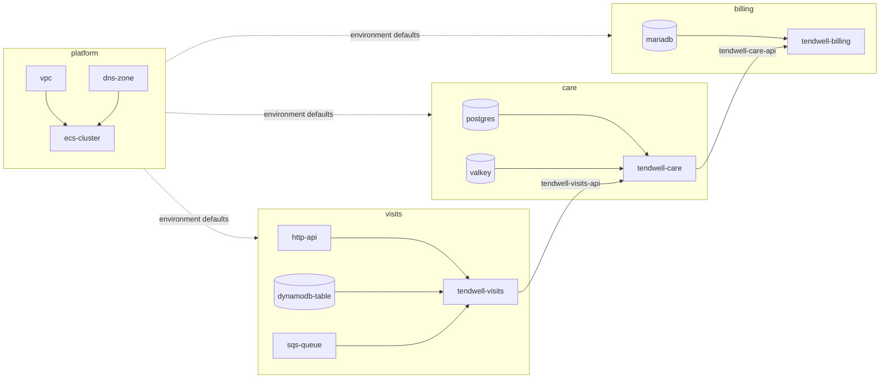

# Tendwell Health


A telehealth company built on this catalog. Patients book video visits, clinicians chart them, and a billing team files the insurance claims.

| Project | Team | What runs there |
|---|---|---|
| `platform` | Platform Engineering | `vpc`, `dns-zone`, `ecs-cluster`, `github-actions-oidc` |
| `apps` | Platform Engineering | App onboarding: `ecr-repository`, `massdriver-project`, `github-repo`, `codebase` |
| `visits` | Patient Experience | The booking API on Lambda: `ecr-repository`, `http-api`, `dynamodb-table`, `sqs-queue`, `tendwell-visits` twice (the API, and the reminder sender) |
| `care` | Clinical | The clinician portal on ECS: `ecr-repository`, `postgres`, `valkey`, `s3-bucket`, `tendwell-care` |
| `billing` | Revenue | Claims on ECS: `ecr-repository`, `mariadb`, `s3-bucket`, `tendwell-billing` |

`platform`, `visits`, `care` and `billing` have `dev` and `prod`. `apps` has one environment per app: deploying `apps-visits` creates Visits' GitHub repository, pipeline and Massdriver project. Prod deploys need a second person's approval.

Each team's group can change only its own project and read the rest. Platform Engineering can change everything, and Security & Compliance can read everything and change nothing.



## The apps

Each app in [applications/](applications/) has:

- `src/`: the app and its Dockerfile.
- `bundle/`: the app's bundle. It has no infrastructure code of its own: it runs on the catalog's `lambda-function` or `ecs-service` runtime, and adds the app's connections and the resource it publishes.
- `resource-type/`: that resource, so other apps connect to it by contract. Care reads the Visits API's URL; Billing reads Care's.
- `blueprint.draft.yaml`: the project's design as a file, in the draft blueprint format.

## Stand it up

You need an organization with a service account in the Organization Admin group, AWS CLI credentials for the account to deploy into, and a domain whose Route 53 zone is in that account. You also need `mass`, `tofu`, `jq`, `docker` and `python3` with PyYAML.

```bash
export MASSDRIVER_API_KEY=... MASSDRIVER_ORG_ID=...
export DOMAIN=tendwell.example PARENT_ZONE_ID=Z0123456789ABCDEFGHIJ

./deploy.sh all dev
```

That makes the IAM role Massdriver deploys with, trusting your organization's identity tokens; sets up a daily AWS Cost and Usage Report and connects it to Massdriver, so every instance shows what it costs; defines the `team` and `data_classification` attributes, tags every cloud resource with them, and creates a repository for every bundle; publishes the catalog and the apps; applies [bootstrap.tf](bootstrap.tf) (projects, environments, components, links, groups, policies and the AWS credentials); deploys dev; and builds and ships each app. Before it touches AWS it lists the account, everything it will create and roughly what it costs, and waits for you to type `yes`. For a separate prod account, make a role there from the AWS IAM Role credential's instructions and set `PROD_ROLE_ARN`. The apps then answer at `visits.dev.<domain>`, `care.dev.<domain>` and `billing.dev.<domain>`.

Run `./deploy.sh` alone to see the individual steps.
